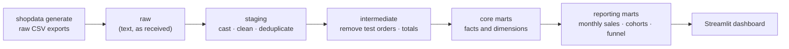

# E-commerce Analytics Engineering


Turns messy raw exports from an online store into **tested, documented, trusted tables** for reporting: sales, customer cohorts and the purchase funnel. Built with **dbt** on **DuckDB**, it runs on a laptop in under a minute with no database server.

> Independent personal project. The store, its customers and all data are synthetic.

---

## The business problem

A fictional online store sells home and office products in five European countries. Every team computes "revenue" and "customers" in its own spreadsheet, and the numbers never match:

- some customers appear twice in the export;
- the same order status is written in several ways (`completed`, `Completed`, `COMPLETE`);
- internal test orders from the QA team are mixed with real ones;
- orders and website visits come from two systems that nobody reconciles.

**Goal:** one shared set of tables with clear definitions, where every rule is written once, tested automatically and documented.
Requirements and acceptance criteria: [docs/requirements.md](docs/requirements.md).

## How it works



| Layer | What happens | Example |
|---|---|---|
| **raw** | CSV files exposed as views, every column as text | `raw.orders` |
| **staging** | One model per source table: types, cleaning, one spelling per value, duplicates removed | `stg_orders`, `stg_customers` |
| **intermediate** | Business logic shared by several marts | `int_orders` (no test orders, with totals) |
| **core marts** | Facts and dimensions with **enforced contracts** | `fct_orders`, `dim_customers`, `fct_sessions` |
| **reporting marts** | Ready-to-use tables for the dashboard | `rpt_monthly_sales`, `rpt_cohort_retention`, `rpt_funnel_monthly` |

Details and lineage: [docs/architecture.md](docs/architecture.md) · Metric definitions: [docs/metrics.md](docs/metrics.md) · Data quality issues and how each one is handled: [docs/data-quality.md](docs/data-quality.md)

## What makes the numbers trustworthy

| Technique | Where | What it protects |
|---|---|---|
| **Generic tests** | every model's YAML | unique and not-null keys, allowed values, relationships between tables, no negative amounts |
| **Singular tests** | [`data_tests/`](data_tests) | revenue is the same from orders and from order lines; every order has exactly one purchase visit; no test account reaches reporting |
| **Unit tests** | [`_staging.yml`](models/staging/_staging.yml), [`_core.yml`](models/marts/core/_core.yml) | the logic itself, on small hand-written inputs: status spellings, customer type, cohort month |
| **Model contracts** | `fct_orders`, `dim_customers` | column names and types cannot change by accident and break the dashboard |
| **Incremental model** | `fct_web_events` | the largest table only loads new events, re-reading 3 days for late arrivals |
| **CI** | GitHub Actions | lint, Python tests, then two `dbt build` runs (partial data, then full) to prove the incremental load |

`dbt build` runs 6 views, 9 tables and 1 incremental model, with 58 data tests and 2 unit tests.

## Quick start

Requirements: Python 3.11 or newer.

```bash
git clone https://github.com/ang-ai-tech/ecommerce-analytics-engineering.git
cd ecommerce-analytics-engineering
python -m venv .venv
source .venv/bin/activate            # Windows: .venv\Scripts\activate
pip install -e ".[dashboard,dev]"

shopdata generate                    # write the raw CSV files to data/raw/
dbt build                            # build and test every model -> data/warehouse.duckdb
streamlit run dashboard/app.py       # dashboard on http://localhost:8501
```

Explore the models, columns and lineage graph in the dbt documentation:

```bash
dbt docs generate
dbt docs serve
```

### Try the incremental load

```bash
shopdata generate --until 2026-06-30   # the data known at the end of June
dbt build
shopdata generate                      # three more months arrive
dbt build                              # fct_web_events adds only the new events
```

## Dashboard

| Section | Question it answers |
|---|---|
| KPIs | How much did we sell, how many orders, what is the average order value, how many buyers come back? |
| Revenue per month | Is the store growing? |
| New and returning customers | Is growth coming from new or returning customers? |
| Revenue per category | Which product categories sell most? |
| Purchase funnel | Out of all visits, how many reach the cart, the checkout and the purchase? |
| Cohort retention | Of the customers who first bought in a month, how many buy again 1, 2, 3... months later? |

## Key design decisions

| Decision | Why | ADR |
|---|---|---|
| DuckDB instead of a database server | Runs anywhere with `pip install`; the same dbt models work on Snowflake or BigQuery | [0001](docs/decisions/0001-duckdb.md) |
| Raw data kept as text, cleaned only in staging | Every cleaning rule lives in one place and is tested | [0002](docs/decisions/0002-clean-once-in-staging.md) |
| Tests at four levels: generic, singular, unit, contracts | Each level catches a different kind of mistake | [0003](docs/decisions/0003-testing-strategy.md) |

## Project structure

```
├── src/shopdata/          # synthetic data generator (`shopdata generate`)
├── models/
│   ├── staging/           # one model per raw table + sources + unit test
│   ├── intermediate/      # shared business logic
│   ├── marts/core/        # facts and dimensions (contracts, incremental)
│   ├── marts/reporting/   # tables for the dashboard
│   └── exposures.yml      # the dashboard, visible in the lineage graph
├── data_tests/            # singular and custom generic dbt tests
├── macros/                # raw views, schema naming
├── dashboard/app.py       # Streamlit dashboard
├── tests/                 # pytest for the generator
└── docs/                  # requirements, architecture, metrics, data quality, ADRs
```

## Limitations & next steps

- Prices include VAT and there are no discounts, shipping costs or currencies other than euro: revenue is simply what customers paid.
- A refund is treated as the whole order being refunded; partial refunds are not modelled.
- Web events are synthetic and simpler than real tracking data (no bots, no cross-device visits).
- Possible extensions: dbt snapshots to keep the history of customer changes, a semantic layer for metric definitions, source freshness checks, a Power BI version of the dashboard.

## License

[MIT](LICENSE)
