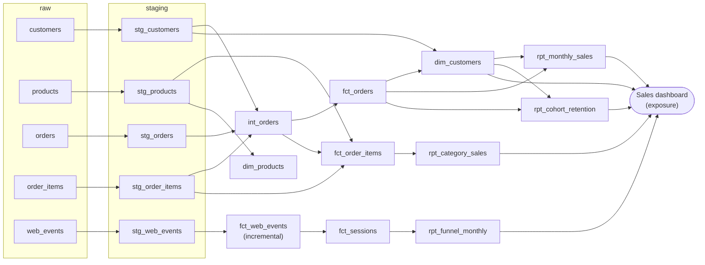

# Architecture

## Lineage

`dbt docs generate && dbt docs serve` shows the same graph interactively, with every column description.

## Tools

| Tool | Role |
|---|---|
| Python (`shopdata`) | Generates the raw CSV exports, reproducible with a seed |
| DuckDB | The warehouse: one file, `data/warehouse.duckdb`, no server |
| dbt Core + dbt-duckdb | Models, tests, documentation, lineage |
| Streamlit | Dashboard on the reporting marts |
| GitHub Actions | CI: lint, pytest, two dbt builds, docs generation |

## Layers and naming

| Layer | Prefix | Materialization | Rule |
|---|---|---|---|
| raw | — | view on CSV | Data exactly as received, all text |
| staging | `stg_` | view | One model per raw table. Only casting, cleaning and deduplication, no joins |
| intermediate | `int_` | view | Logic used by several marts |
| core marts | `fct_`, `dim_` | table | Facts (events, things that happen) and dimensions (who, what) |
| reporting marts | `rpt_` | table | One table per report, already aggregated |

Each layer reads only from the layer before it, so a rule (for example "remove test orders") is applied in exactly one place.

## Grain of the main tables

| Table | One row per |
|---|---|
| `fct_orders` | order |
| `fct_order_items` | product line in an order |
| `fct_web_events` | website or app event |
| `fct_sessions` | visit (session) |
| `dim_customers` | real customer |
| `dim_products` | product |
| `rpt_monthly_sales` | month |
| `rpt_category_sales` | month and category |
| `rpt_cohort_retention` | cohort month and months since first purchase |
| `rpt_funnel_monthly` | month |

## How raw files become sources

At the start of every dbt command, the `create_raw_views` macro (an `on-run-start` hook) creates one view per CSV file in the `raw` schema. The models then use them as normal dbt sources with `source('shop', 'orders')`. In a cloud warehouse the same sources would point to tables loaded by an ingestion tool: only the macro would go away.

## Incremental load of web events

`fct_web_events` is the largest table (about 80,000 rows here, millions in a real store). On the first run dbt builds it completely. On the next runs it reads only events newer than the latest one already loaded, minus 3 days (`events_lookback_days`), because tracking events can arrive late. Rows that are read again are replaced thanks to `unique_key='event_id'`, so nothing is counted twice. `dbt build --full-refresh` rebuilds it from scratch.

## Tests

See [ADR 0003](decisions/0003-testing-strategy.md).
